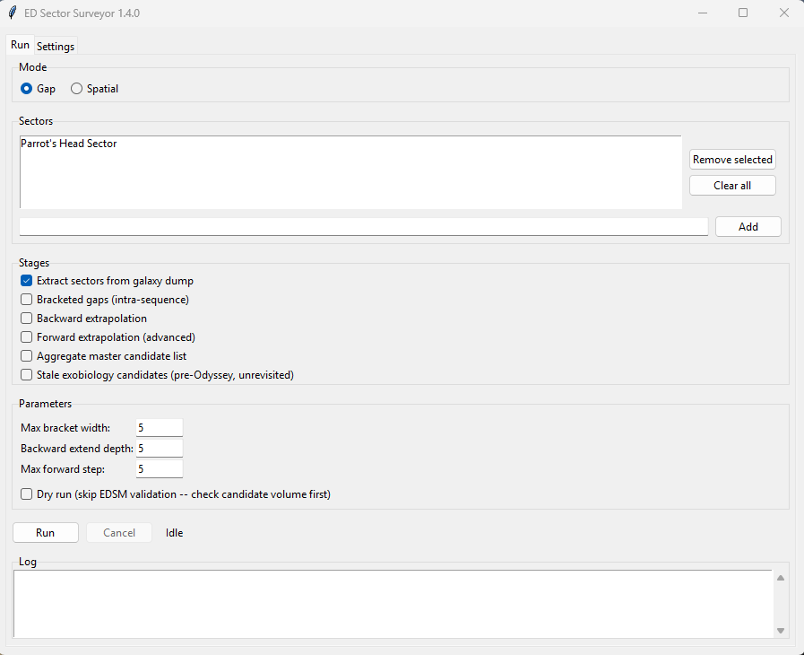

# ED Sector Surveyor


*(Formerly "Sector Surveyor" through v1.3.0, and originally "Sector Gap
Analyzer" through v1.2.0 — same project, same repo history. Renamed again as
of v1.4.0. See [Installation](#installation-end-users) below if you have an
old version installed already.)*

Tooling for identifying **likely-but-undiscovered star systems** in specific
Elite Dangerous procedurally-generated sectors, for exploration flight
planning. Given a sector's known (Spansh-reported) systems, the pipeline
infers plausible names for systems that probably exist but haven't been
scanned/submitted yet, then cross-checks each candidate against EDSM to
filter out anything already known.

This does **not** predict coordinates and cannot prove a candidate exists —
it only narrows an enormous naming space down to a short, explainable list
worth flying to check. See [`docs/gap-finder.md`](docs/gap-finder.md) for the
original design rationale (note: that document describes a more elaborate
scoring model than what's actually implemented — see
[Relationship to docs/gap-finder.md](#relationship-to-docsgap-findermd) below).



## Installation (end users)

If you just want to run the app rather than work with the scripts directly:

1. Download the latest installer (`EDSectorSurveyor-Setup-X.Y.Z.exe`) from this
   repo's [Releases](../../releases) page and run it. It installs per-user (no
   admin rights needed) and adds a Desktop/Start Menu shortcut. Since the
   installer and app aren't code-signed, Windows SmartScreen (and possibly
   your antivirus) will treat it with suspicion the first time — see
   [Antivirus and SmartScreen warnings](#antivirus-and-smartscreen-warnings)
   below before you download, so you know what to expect and how to verify
   the file.
2. Download your own copy of the full Spansh galaxy dump — `galaxy.json.gz`,
   the **full/all-systems** dump, not the "populated systems only" one (see
   [Source data](#1-source-data-the-galaxy-dump) below) — and save it to:
   ```
   %LOCALAPPDATA%\EDSectorSurveyor\workspace\source_data\galaxy.json.gz
   ```
   That's the default the app already looks for, so placing it there means
   the Settings tab needs no changes. If you'd rather keep your dump
   somewhere else (e.g. shared across other projects), use the **Browse**
   button in the Settings tab to point at it instead.
3. Launch **ED Sector Surveyor** from the Desktop shortcut. Check the
   Settings tab (workspace folder + galaxy dump path), then use the Run tab:
   add one or more sector names, pick which stages to run, and hit Run. The
   app will refuse to start (and jump you to Settings) if the galaxy dump
   path doesn't point to a real file.

Building from source instead (for development, or to build your own
installer) is covered in [Dependencies](#dependencies) and
[Building a release](#building-a-release) below.

**Upgrading from Sector Surveyor (pre-v1.4.0) or the original Sector Gap
Analyzer (pre-v1.3.0)?** ED Sector Surveyor installs as a separate app — it
won't overwrite or interfere with an existing Sector Surveyor or Sector Gap
Analyzer install. Your settings (workspace folder, galaxy dump path, sector
list, stage toggles) carry forward automatically on first launch from
whichever prior install you have; your sector data isn't affected either
way, since it lives wherever your workspace folder points, not inside the
app install itself. Once you've confirmed ED Sector Surveyor is working,
uninstall the old entry (or entries) from Windows Settings/Control Panel
whenever convenient — there's no rush.

## Antivirus and SmartScreen warnings — what to expect and what to do

ED Sector Surveyor is a small open-source tool. Its releases are currently
**not code-signed** (code-signing certificates are expensive and reputation
takes time to build), so Windows and some antivirus products will treat the
installer with suspicion the first time they see it. **This is expected and
does not mean anything is wrong with the file** — it means Windows has never
seen this exact file before and no publisher identity is attached to it.
You can (and should) verify the download yourself; instructions below.

### First: verify your download

Every release on the [Releases](../../releases) page lists a SHA-256
checksum for the installer. After downloading, open PowerShell and run:

    Get-FileHash .\EDSectorSurveyor-Setup-X.Y.Z.exe -Algorithm SHA256

If the hash printed matches the one in the release notes, your file is
byte-for-byte the one the maintainer published, and the warnings below are
safe to click through. If it does **not** match, delete the file and
re-download from the Releases page only — never from a third-party mirror.

### "Windows protected your PC" (SmartScreen) — blue dialog

This appears because the installer is new and unsigned, not because
anything harmful was detected. If your checksum matched:

1. Click **More info**.
2. Click **Run anyway**.

That's it — SmartScreen only gates the first run.

### Your antivirus flags, quarantines, or deletes the file

Some antivirus products go further than a warning and quarantine the
installer or the installed `EDSectorSurveyor.exe`. This is a **false
positive** with a known cause: the app is packaged with PyInstaller (a
standard tool that bundles a Python program and the Python runtime into an
exe), and because some actual malware is also built with PyInstaller, a few
antivirus engines flag *everything* built with it. See PyInstaller's own
[note on antivirus false positives](https://github.com/pyinstaller/pyinstaller/blob/develop/.github/ISSUE_TEMPLATE/antivirus.md).

If this happens:

1. **Verify the checksum first** (above). Only proceed if it matches.
2. **Restore the file from quarantine** using your AV's quarantine/history
   screen (the wording varies: "Restore", "Allow", "Not a threat").
3. **Add an exclusion** so it doesn't recur — either for the installer
   file, or (after installing) for the app folder:
   `%LOCALAPPDATA%\Programs\EDSectorSurveyor`
   In Windows Security this is under: Virus & threat protection →
   Manage settings → Exclusions → Add or remove exclusions.
4. Optionally, **report the false positive** to your AV vendor — this
   genuinely helps: enough reports get the file whitelisted for everyone.

**Never add exclusions for files whose checksum you haven't verified.**
The verify-then-restore order matters: the checksum is what tells you the
flagged file really is the one published here.

### Why not just sign the releases?

Code signing is a possible future improvement (e.g. via
[SignPath Foundation](https://signpath.org/), which offers free signing for
qualifying open-source projects) but isn't in place yet. Until then,
checksums + this documentation are the interim answer. If a release is ever
signed, this section will be updated.

## How candidates are generated

Elite Dangerous procedural system names follow a `<Sector> <Subsector> <mass
code><number>` pattern, e.g. `Outopps FG-Y d1-23`. Within one "family"
(everything except the trailing number), Stellar Forge tends to allocate
numbers roughly in order, so gaps in the known numbers are informative:

- **Bracketed gaps** (`scripts/gap_full_export.py`) — a missing number that
  sits strictly between two *consecutive* known numbers in a family (e.g.
  known `...12, 14...` → candidate `13`). This is the strongest signal: the
  candidate is boxed in on both sides by confirmed systems. Gaps wider than
  `--max-bracket-width` (default 25) are skipped — a very wide unbracketed
  stretch is more likely a number Stellar Forge never allocated than a real
  missing system.
- **Backward extrapolation** (`scripts/gap_extrapolate_export.py --direction
  backward`) — numbers below a family's known minimum, down toward 0 (e.g.
  known minimum `d1-5` → candidates `d1-4, d1-3, d1-2, d1-1, d1-0`). Bounded
  by `--extend-depth` (default 5).
- **Forward extrapolation** (same script, `--direction forward`) — numbers
  above a family's known maximum, chain-extended only while EDSM keeps
  confirming each step. Not currently part of the standard run for this
  project (see below) but available if needed.
- **Spatial search** (`scripts/gap_spatial_export.py`) — the same bracketed-gap
  and backward-extrapolation logic, but only for the boxels within a chosen
  radius (light years) of a center system instead of an entire sector
  prefix. Useful for a quick, targeted search around wherever you
  currently are in-game rather than analyzing a whole sector. See
  [Spatial search](#spatial-search) below.

Every candidate is checked against the [EDSM](https://www.edsm.net/) API
(`GET /api-v1/system?systemName=...`) and only kept if EDSM has no record of
it — i.e. it's not just "missing from Spansh," it's missing everywhere we can
cheaply check.

The trailing token of a procedural name (e.g. `d1-23`) further breaks down
into a **mass code** (`d`, one letter) and a **boxel** number (`1`) followed
by a **serial** number (`23`). Output lists are sorted sector → subsector →
mass code → boxel → serial — the order these tokens actually read in-game —
so candidates near each other on the map land together, regardless of which
method (bracketed gap, backward, spatial, etc.) found them.

## Pipeline

```
1. Source data (galaxy.json.gz)              — you supply this, see below
        │
        ▼
2. Extraction → data/sector_library/*.sqlite  — scripts/extract_sector_systems_to_sqlite.py
                                                 scripts/extract_multi_sector_to_sqlite.py (many sectors, one pass)
        │
        ├──► Sector summary → sector_<slug>_summary.md   — scripts/sector_summary_export.py
        │                                                   (GUI: automatic right after extraction)
        ▼
3. Candidate generation + EDSM validation     — scripts/gap_full_export.py            (bracketed gaps, whole sector)
                                                 scripts/gap_extrapolate_export.py      (backward/forward, whole sector)
                                                 scripts/gap_spatial_export.py          (bracketed gaps + backward,
                                                                                          radius around a system)
        │
        ▼
4. Cross-sector aggregation → out/            — scripts/aggregate_gap_master_list.py
        │
        ▼
5. Survey clusters (regions → clusters, map)  — scripts/gap_cluster_export.py
```

A separate, optional path (`scripts/sector_survey.py`) surveys an already-
extracted sector DB for high-value systems (Earth-like/Water/Ammonia worlds,
dense icy/metallic rings, biosignature counts), cross-checks claim status via
the Spansh search API, and looks for spatial clusters of interesting systems.
This is independent of the gap/extrapolation candidate pipeline.

### 1. Source data: the galaxy dump

Nothing in this repo ships with system data. You need a local copy of a full
[Spansh](https://spansh.co.uk/dumps) galaxy dump — **not** the "populated
systems only" dump; extraction needs every system, populated or not, so gaps
in procedural naming sequences can be detected.

This is a large file: tens to over a hundred GB compressed. It can be either:
- a JSON array document (`[ {...}, {...}, ... ]`, one object per line) — this
  is what Spansh's full dump uses, and it requires the `ijson` package to
  stream without loading the whole thing into memory, or
- JSON Lines (one bare JSON object per line, no enclosing `[...]`) — detected
  automatically either way (`detect_format()` in
  `scripts/extract_sector_systems_to_sqlite.py`).

Point extraction at your local copy with `--input`, or set the
`MFI_GALAXY_DUMP` environment variable so scripts default to it:

```bash
export MFI_GALAXY_DUMP="/path/to/galaxy.json.gz"
```

Because decompression + JSON parsing dominates the cost of a pass over this
file (not the sector filter itself), **prefer
`extract_multi_sector_to_sqlite.py` over running the single-sector extractor
repeatedly** whenever you need more than one sector — it streams the dump
once and routes matching systems to N separate output databases in the same
pass. As a reference point, a 113 GB compressed dump on typical hardware
extracted at ~6,000–7,000 systems/sec, i.e. roughly 4–5 hours for a full
single pass regardless of how many sectors you extract from it in that pass.

### 2. Extraction

Single sector:

```bash
python scripts/extract_sector_systems_to_sqlite.py \
    --input "/path/to/galaxy.json.gz" \
    --sector_prefix "Outopps"
```

Multiple sectors in one pass (recommended whenever extracting >1 sector):

```bash
python scripts/extract_multi_sector_to_sqlite.py \
    --input "/path/to/galaxy.json.gz" \
    --sector_prefix "Outopps" --sector_prefix "Oochost" --sector_prefix "Oesotl"
```

Both write to `data/sector_library/sector_<slug>.sqlite` by default (three
tables: `systems`, `bodies`, `rings`, plus a `raw_json` column on each for
anything not explicitly mapped). Use `--limit N` on either script to sample a
prefix of the dump first and gauge throughput before committing to a full run
on very large source files.

Sector-prefix matching requires a token boundary (the prefix must be the
whole system name or be followed by a space), so `"Oochost"` won't
accidentally match an unrelated system starting with those same letters.

### Sector summaries

```bash
python scripts/sector_summary_export.py \
    --db data/sector_library/sector_outopps.sqlite --sector "Outopps"
```

Writes `data/sector_library/sector_<slug>_summary.md`: total systems/bodies/
rings, median ring density per class, Earth-like-world and bio-signature
hotspot subsector patterns, and a couple of "priority search" pointers
derived from the strongest patterns. The GUI runs this automatically for
every sector right after extraction; run it standalone if you extracted a
sector before this existed, or want to refresh one.

### 3. Candidate generation + validation

Run per sector, against its extracted DB:

```bash
# Bracketed gaps (dry-run first to see volume before spending EDSM calls):
python scripts/gap_full_export.py --db data/sector_library/sector_outopps.sqlite \
    --sector "Outopps" --out-dir out --dry-run
python scripts/gap_full_export.py --db data/sector_library/sector_outopps.sqlite \
    --sector "Outopps" --out-dir out

# Backward extrapolation only (no forward chaining):
python scripts/gap_extrapolate_export.py --db data/sector_library/sector_outopps.sqlite \
    --sector "Outopps" --out-dir out --direction backward --dry-run
python scripts/gap_extrapolate_export.py --db data/sector_library/sector_outopps.sqlite \
    --sector "Outopps" --out-dir out --direction backward
```

Both scripts write CSV + Markdown per phase into `--out-dir` (use the same
`out/` directory for every sector so the aggregator in step 4 can find
everything). Both throttle EDSM lookups to **1 request/second** and cache
results (default: an `edsm_cache` table inside the sector DB itself, 7-day
TTL) so re-runs only pay for new candidates. For a sector of unknown size,
always run `--dry-run` first — candidate volume (and therefore validation
wall-clock time) can vary by orders of magnitude between sectors depending on
how sparse and wide their naming families are.

### Spatial search

```bash
python scripts/gap_spatial_export.py --db data/sector_library/sector_outopps.sqlite \
    --sector "Outopps" --center-system "Outopps FG-Y d1-23" --radius-ly 20 --out-dir out
```

Requires the sector containing `--center-system` to already be extracted
(step 2) — it doesn't touch the galaxy dump itself, only the sector DB. Runs
bracketed-gap and backward-extrapolation candidate generation
(`--direction bracketed_gap` / `backward` / `both`, default `both`) for every
boxel in range of the center system: one whose known systems' centroid, or
any one of its known systems, lies within `--radius-ly`. The second
condition keeps boxels that straddle the sphere's edge. Candidates are
always checked against every known system in the sector DB, not just those
inside the sphere. Writes `<slug>_spatial_gap_*` / `<slug>_spatial_backward_*` CSV +
Markdown into `--out-dir`, picked up by the aggregator like any other sector
output. In the GUI, switch the **Run** tab's Mode to **Spatial** and fill in
Center system / Radius (ly) — the sector is auto-detected from the center
system's name unless you set an override.

The spatial CSVs add a `boxel_distance_ly` column: the distance from the
center to the candidate boxel's known-system centroid. It can slightly
exceed the radius for a boxel straddling the edge, and an undiscovered
system can sit anywhere in its boxel's cube (20–160 ly across, by mass code).

**Fixed in v1.5.1:** earlier versions treated only systems *inside* the
radius as known, so known systems just outside it — sequence neighbours of
systems inside — came back as bracketed-gap and backward "candidates". EDSM
validation doesn't reliably catch these, because Spansh holds many systems
EDSM doesn't. Around a well-explored hub, almost all of an older spatial
run's results can be already-known systems; re-run any spatial search made
before v1.5.1.

### 4. Aggregation

```bash
python scripts/aggregate_gap_master_list.py --out-dir out
```

Scans `out/` for every sector's `*_gap_full_validated.csv`,
`*_extrap_backward_validated.csv` / `*_extrap_forward_step*.csv`, and
`*_spatial_gap_validated.csv` / `*_spatial_backward_validated.csv`, keeps
only rows EDSM has no record of (`edsm_status == not_in_edsm`), tags each
with its sector and candidate type, and writes one combined
`master_gap_candidates.csv` + `.md` — grouped by sector, then subsector, then
mass code, then boxel, then serial (the in-game reading order), so
candidates near each other on the map land together regardless of which
method found them. Candidate type and `steps_from_edge` only break ties
within an identical location. No composite "confidence score" is invented —
the underlying data doesn't support anything more precise than structural
ordering.

The CLI scan above deliberately sweeps *everything* in `out/` (narrow it
with `--sector`, or pass `--files` to aggregate specific CSVs). The GUI's
"Aggregate master candidate list" stage is session-scoped instead: it
aggregates only the candidate files written during that run and saves them
as `master_gap_candidates_<YYYYMMDD-HHMMSS>.csv` + `.md` (UTC session start
time), with the session's sectors and source files listed in the `.md`
header. Earlier sessions' masters are left untouched.

### 5. Survey clusters

```bash
python scripts/gap_cluster_export.py --db data/sector_library/sector_Outopps.sqlite \
    --sector Outopps --files out/outopps_gap_full_validated.csv out/outopps_extrap_backward_validated.csv
```

Candidates are undiscovered, so they have no coordinates — but each one's
**boxel** (subsector + mass code + boxel number, e.g. `AS-S c17`) is a fixed
cube of space, and the sector DB almost always holds known systems in that
same boxel. Each candidate boxel is placed at the centroid of those known
boxel-mates, then grouped into nested proximity groups for planning a field
survey:

- **Regions** — at most `--region-ly` across (default 450 ly)
- **Survey clusters** inside each region — at most `--cluster-ly` across
  (default 150 ly)

Both levels are cuts of one complete-linkage tree, so clusters always nest
inside regions. Regions, and clusters within each region, are numbered in a
suggested visiting order (nearest-neighbour + 2-opt) starting from the region
nearest the survey start. Each cluster names a known system near its centre
("Plot to") to use as a galaxy-map route destination.

**Fly the candidates CSV in `visit_order`.** Inside each cluster the stops
(`cluster_stop`) are its boxels, routed the same way starting from the boxel
nearest the "Plot to" system. Every candidate at a stop shares one estimated
position, so they're listed together, bracketed gaps first, then
extrapolated candidates nearest their known edge first. The number survives
filtering and re-sorting in a spreadsheet, and skipping candidates that turn
out not to exist rarely makes the next leg much longer. On Hypiae Aim this
routing cuts in-cluster travel by about 39% versus listing boxels
alphabetically.

**Survey start** (`--start-system`, or the GUI's "Survey start" field):
where the visiting order begins. Accepts a system name from *any* extracted
sector (useful when your carrier or colony is outside the sector you're
surveying), `x, y, z` coordinates for anywhere else (EDSM and Spansh both
show them), or `Sol`. Left blank it's Sol in Gap mode and the center system
in Spatial mode. The GUI checks it before the EDSM stages start, so a typo
fails in seconds rather than after a long run. It only changes which region
comes first and how the rest are sequenced, not the clusters themselves.

Grouping on the bare subsector letters would be wrong: the same letters
recur for every mass code, hundreds of light years apart.

For procedurally named sectors the boxel's cube is also decoded from the name
(`cube_*` columns), once the sector's own known systems confirm the grid;
hand-authored sectors (e.g. "NGC 1528 Sector") don't follow that grid, so
those columns stay blank there. Either way, a candidate can be anywhere
inside its boxel's cube (edge: b 20 ly, c 40 ly, d 80 ly, e 160 ly), so
treat cluster outlines as approximate.

Outputs: `<sector>_survey_clusters.md` (report), `.csv` (one row per
cluster), `.svg` (plan + side-view map; hover a dot for its cluster/boxel),
and `<sector>_candidates_clustered.csv` (every candidate with its region,
cluster, boxel position and anchor system). In the GUI this is the "Survey
clusters" stage, run per sector on that session's EDSM-validated candidates
(skipped on dry runs, which have none); cluster/region sizes and the
survey start are under Parameters.

## Dependencies

For running from source: `pip install -r requirements.txt`. For building the
packaged app/installer yourself: `pip install -r requirements-dev.txt` (adds
PyInstaller on top of the runtime requirements).

- **Python 3.10+** (uses `from __future__ import annotations`, PEP 604 unions
  in a few places).
- **`ijson`** — required for extraction whenever the source dump is a JSON
  array document rather than JSON Lines (this is the case for Spansh's full
  dump). Performance depends heavily on backend — check which one you have
  with `python -c "import ijson; print(ijson.backend)"`; `yajl2_c` (a
  compiled C backend) is dramatically faster than the pure-Python fallback.
- **`aiohttp`** (not in requirements.txt — install separately if needed) —
  only used by `scripts/sector_survey.py` and `scripts/pencil_sector_survey.py`
  for querying the Spansh systems-search API. Not required for extraction or
  for the gap/extrapolation scripts or the GUI, which use the standard
  library `urllib` against EDSM.
- Everything else (`sqlite3`, `csv`, `json`, `argparse`, `tkinter`, ...) is
  standard library.

**Troubleshooting: EDSM calls fail with an SSL/certificate error.** This
usually means antivirus software with TLS/HTTPS inspection (e.g. Norton Web
Shield) is intercepting the connection with a certificate Python doesn't
trust. Try `pip install pip-system-certs`, which makes Python defer to the
Windows certificate store (where such software's inspection root is usually
already trusted) — not a hard dependency, just a fix for this specific
environment issue if you hit it.

## Building a release

Packaging is manual (no CI currently) — from a Windows machine with
[Inno Setup](https://jrsoftware.org/isinfo.php) installed:

```bash
pip install -r requirements-build.lock
pyinstaller EDSectorSurveyor.spec --clean
iscc installer.iss
```

`requirements-build.lock` pins the exact dependency versions an official
release was built with (unlike `requirements.txt`/`requirements-dev.txt`,
which use minimum-version ranges for general development). Record the Python
version used in the release notes alongside it. Optionally set
`SOURCE_DATE_EPOCH` (to the release's Unix timestamp) before building for
closer build-output reproducibility — PyInstaller otherwise embeds the
current time.

This produces `dist/EDSectorSurveyor/` (the onedir PyInstaller build) and
then `dist-installer/EDSectorSurveyor-Setup-X.Y.Z.exe` (the installer, via
`installer.iss`). Bump `MyAppVersion` in `installer.iss` **and** `filevers`/
`prodvers`/`FileVersion`/`ProductVersion` in `version_info.txt` together
before building a new release. Neither `dist/`, `dist-installer/` are
committed to git (see `.gitignore`) — attach the built installer `.exe` to a
new GitHub Release instead, along with its SHA-256 checksum
(`Get-FileHash .\EDSectorSurveyor-Setup-X.Y.Z.exe -Algorithm SHA256`); it's
a compiled binary and doesn't belong in git history.

## Repository layout

```
scripts/
  extract_sector_systems_to_sqlite.py   Single-sector extraction from a galaxy dump
  extract_multi_sector_to_sqlite.py     Multi-sector extraction in one pass over the dump
  sector_summary_export.py              Sector baseline summary report (ring/ELW/biosig stats), run after extraction
  gap_naming.py                         Shared procedural-name parsing + sector/subsector/mass-code/boxel/serial sort key
  gap_full_export.py                    Bracketed intra-sequence gap candidates + EDSM validation
  gap_extrapolate_export.py             Backward/forward extrapolation candidates + EDSM validation
  gap_spatial_export.py                 Bracketed gaps + backward extrapolation within a radius of a system
  aggregate_gap_master_list.py          Merge per-sector CSVs into one master candidate list
  gap_cluster_export.py                 Group candidates into nested survey regions/clusters by boxel location, with map
  sector_survey.py                      High-value system survey for an extracted sector DB (independent of gap pipeline)
  pencil_sector_survey.py               One-off hardcoded survey script for the Pencil Sector (not general-purpose)

gui/
  app.py           Tkinter window: Mode (Gap/Spatial), sector list or spatial search fields, stage/parameter
                    options, Run/Cancel, live log, Settings tab
  worker.py        Background-thread job runner (stdout capture, cooperative cancellation)
  pipeline.py      Orchestrates the scripts/ pipeline (sector or spatial mode) for the GUI
  config.py        Persisted settings (%APPDATA%\EDSectorSurveyor\config.json)
  main.py          Entry point (`python -m gui.main`, and the PyInstaller build target)

EDSectorSurveyor.spec PyInstaller build spec (onedir, custom icon)
installer.iss            Inno Setup script that wraps the PyInstaller build into an installer
icon.ico / icon.png       App icon (.ico is what's actually embedded in the build)
requirements.txt          Runtime dependencies
requirements-dev.txt      Adds build-time dependencies (PyInstaller) on top of requirements.txt

tests/                   Standard-library unittest suite: python -m unittest discover -s tests

data/sector_library/     Extracted per-sector SQLite DBs + summary reports (gitignored: *.sqlite, *.md)
out/                     Generated candidate CSVs/Markdown reports (gitignored)
docs/gap-finder.md       Original design document / methodology notes
```

### A note on removed leftover code

This repo was originally split out from a larger project (`edmfi-mfi`), and
for a while carried three leftover pieces from that split: `planner/`
(imported elsewhere as `planner_strategic`), `tests/test_strategic_planner.py`,
and `scripts/offline_gap_lists.py`. All three referenced modules that never
existed in this repo (`app.config`, `planner_strategic`) and could not be
imported or run here. They've since been deleted rather than left in place —
notably, `planner/edsm.py` contained a second, unreachable copy of an EDSM
error-handling bug (silently treating a failed API check as "confirmed not
in EDSM," and caching that false negative) that was already found and fixed
in the actively-used pipeline; keeping a dead copy of the same bug around
was a landmine for anyone who might have reconnected that code later. The
full pipeline is everything listed under "Repository layout" above.

### Relationship to `docs/gap-finder.md`

The design doc describes a two-tier methodology with computed confidence
scores (`density_score`, `bracket_score_norm`, `family_strength_score`, a
weighted `priority_score`, spatial neighborhood anchoring, etc.). The scripts
that actually exist today implement a simpler subset: bracketed-gap detection
with a bracket-width cap, and backward/forward extrapolation gated by EDSM
confirmation — no computed composite score, no scored spatial-anchoring tier
(the doc's `density_score`-weighted neighborhood concept). `gap_spatial_export.py`'s
"spatial search" is a different, later addition: an unscored radius filter on
which boxels the same bracketed-gap/backward logic is applied to, not the
doc's confidence-weighted anchoring. Treat the doc as background on the
*reasoning* behind the approach, not as a spec that matches the current code
line-for-line.

## Output format reference

`gap_full_export.py`, `gap_extrapolate_export.py`, and `gap_spatial_export.py`
write CSVs with a shared schema (see `scripts/gap_naming.py`) so
`aggregate_gap_master_list.py` can merge them:

| Column | Meaning |
|---|---|
| `system_name` | Candidate system name |
| `edsm_status` | `not_in_edsm` (kept), `in_edsm` (filtered out), `skipped` (dry-run) |
| `direction` | `bracketed_gap` or `backward` (or `forward`, sector mode only) |
| `steps_from_edge` | For backward/forward: distance from the known edge (1 = adjacent) |
| `spansh_edge_number` | The known min (backward) or max (forward) the candidate extends from |
| `family` | Sector + subsector token, e.g. `Outopps FG-Y` |
| `subsector` | Just the subsector token, e.g. `FG-Y` |
| `mass_prefix` | The mass-code letter + boxel number, e.g. `d1` |
| `mass_code` | Just the mass-code letter, e.g. `d` |
| `boxel` | Just the boxel number, e.g. `1` |
| `number` | The candidate's trailing serial number |

`gap_spatial_export.py`'s CSVs add three more columns: `center_system` and
`radius_ly`, recording the search that produced each row, and
`boxel_distance_ly` (see [Spatial search](#spatial-search)).

**Sample output**: [`sample_master_gap_candidates.csv`](docs/samples/sample_master_gap_candidates.csv)
/ [`.md`](docs/samples/sample_master_gap_candidates.md) — real, EDSM-validated
output for one sector (Flaming Star Sector, 47 candidates), included as a
concrete example of what `aggregate_gap_master_list.py` produces. A short
excerpt of the Markdown version:

```markdown
# Master Gap / Extrapolation Candidate List

Total candidates (not in EDSM): 47

## Summary

| Sector | Bracketed Gap | Backward Extrap | Forward Extrap | Spatial Gap | Spatial Backward | Total |
|--------|--------------:|-----------------:|----------------:|------------:|-----------------:|------:|
| flaming_star_sector | 19 | 28 | 0 | 0 | 0 | 47 |

## flaming_star_sector

### Bracketed Gaps (intra-sequence)

**Flaming Star Sector GW-W** (1):

  - Flaming Star Sector GW-W d1-1
```

## Caveats

- Candidates are hypotheses, not confirmed systems. `not_in_edsm` means
  "unreported to Spansh or EDSM," which includes real-but-undiscovered
  systems, real-but-unsubmitted discoveries, *and* numbers Stellar Forge
  simply never used.
- Source data goes stale — Spansh dumps are periodic snapshots, and both
  Spansh and EDSM coverage grow over time as more commanders explore and
  submit data. Re-running validation against a fresh dump/cache periodically
  will change results.
- EDSM's 1 request/second throttle means validation time scales with
  candidate volume; always check with `--dry-run` before a full run on an
  unfamiliar sector.

## Acknowledgments

This project exists only because of data and infrastructure built and
maintained by others, freely made available to the community:

- **[Spansh](https://spansh.co.uk/)**, created and maintained by **Gareth
  Harper** — the galaxy dumps this project's entire extraction pipeline is
  built on. Every sector this tool has ever analyzed started as a Spansh
  export.
- **[EDSM](https://www.edsm.net/)** (Elite Dangerous Star Map) and its
  maintainers — the API this tool queries to validate every candidate
  system before it's ever suggested to a player.
- **[EDDN](https://eddn.edcd.io/)** (Elite Dangerous Data Network) and the
  wider **[EDCD](https://github.com/EDCD)** community — the real-time,
  crowdsourced data network that Spansh, EDSM, and the broader third-party
  tool ecosystem are all ultimately built on top of.
- The Elite Dangerous commander community at large — every system this
  project's analysis is built on exists because a player chose to explore
  it and *voluntarily* submit that discovery through an EDDN-compatible
  tool. None of this works without that ongoing, uncompensated community
  contribution.

## Code signing policy

Free code signing provided by [SignPath.io](https://about.signpath.io),
certificate by [SignPath Foundation](https://signpath.org).

**Privacy policy:** This program will not transfer any information to other
networked systems unless specifically requested by the user or the person
installing or operating it. The one exception is user-initiated: when you
run the EDSM validation stage (checking whether a candidate system already
exists), the tool sends candidate system names to the public
[EDSM](https://www.edsm.net/) API — see
[EDSM's privacy policy](https://www.edsm.net/en/faq/privacy-policy). No
other pipeline stage, and no other part of the app, makes network calls.
(Two optional scripts not included in the packaged GUI app —
`scripts/sector_survey.py` and `scripts/pencil_sector_survey.py` —
separately query the [Spansh](https://spansh.co.uk/) API.)

**Team:**

| Role | Member |
|---|---|
| Committers / Reviewers | jenningsmt |
| Approvers | jenningsmt |

## Legal

*Elite Dangerous* is a trademark and copyright of **Frontier Developments
plc**, all rights reserved. This is an unofficial, fan-made tool built by a
player of the game; it is not affiliated with, endorsed by, or sponsored by
Frontier Developments in any way. All Elite Dangerous game data, names, and
imagery referenced here are the property of Frontier Developments plc — see
their fan content policy (on their website) for the terms this project
operates under.
