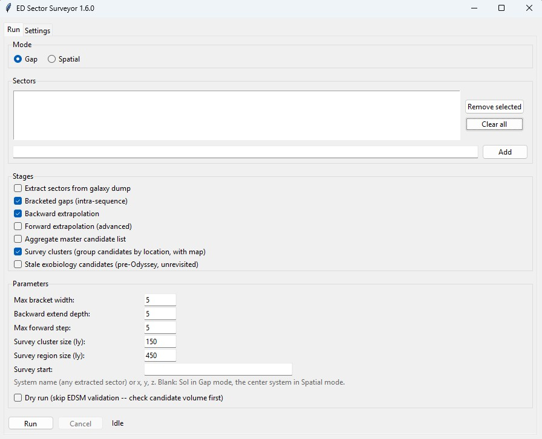

# ED Sector Surveyor: User Guide

*For ED Sector Surveyor v1.7.0 and later.*

This guide is for Elite Dangerous explorers who want to find systems nobody has discovered yet. You don't need to know any programming, and you don't need to have explored much before. If you can plot a route in the Galaxy Map, you can use this tool.

**Contents**

1. [What the tool does, and why you'd want it](#1-what-the-tool-does-and-why-youd-want-it)
2. [Five key ideas](#2-five-key-ideas)
3. [One-time setup](#3-one-time-setup)
4. [A tour of the window](#4-a-tour-of-the-window)
5. [Example 1: Gap Analysis of a whole sector](#5-example-1-gap-analysis-of-a-whole-sector)
6. [Example 2: Spatial Analysis around one system](#6-example-2-spatial-analysis-around-one-system)
7. [Flying the survey: turning candidates into first discoveries](#7-flying-the-survey-turning-candidates-into-first-discoveries)
8. [Tips, troubleshooting and FAQ](#8-tips-troubleshooting-and-faq)
9. [Glossary](#9-glossary)

---

## 1. What the tool does, and why you'd want it

The galaxy in Elite Dangerous has about 400 billion star systems. Players have visited a tiny fraction of them. When you are the first commander to scan a system and sell its data, the game tags it "Discovered by CMDR (your name)" permanently. Most explorers find first discoveries by flying far from the bubble and hoping.

ED Sector Surveyor takes a more systematic approach. It uses the community's shared record of known systems to work out which system names probably exist but haven't been reported yet, then tells you where to fly to find them and in what order.

It does this in four steps:

1. It reads the list of known systems in a sector, from a community data file called the Spansh galaxy dump.
2. It spots missing names. Procedurally generated systems are named in numbered sequences. When a sequence goes ...12, 14... the tool suspects a system 13 exists that nobody has reported.
3. It double-checks each suspect with EDSM, a second community database. It throws out any name EDSM already knows.
4. It groups what's left by location into survey clusters and suggests an order to visit them, with a known system to plot your route to.

Use it when:

- You want to explore a particular sector and get the most first discoveries out of the trip. That's **Gap Analysis** ([Example 1](#5-example-1-gap-analysis-of-a-whole-sector)).
- You care about one spot in space, such as a squadron colony capital, a carrier parking spot, or your current location, and want to know what undiscovered systems are near it. That's **Spatial Analysis** ([Example 2](#6-example-2-spatial-analysis-around-one-system)).

> Every result is a *candidate*, an educated guess. The tool can't prove a candidate exists. The game's galaxy generator has no rule saying it must fill every number in a sequence, so some gaps are numbers it never used. Section 7 shows you how to check a candidate in the Galaxy Map in a few seconds, before you spend any fuel on it.

---

## 2. Five key ideas

### Idea 1: Sectors

The galaxy is divided into named **sectors**, roughly 1,280 light years on each side. Most systems take their name from the sector they're in: everything named `Hypiae Aim ...` is in the Hypiae Aim sector. You tell the tool which sector to work on by typing that first part of the name.

### Idea 2: How a procedural system name is built

Take the name `Hypiae Aim XO-Z d13-31`. It breaks down like this:

| Part | Example | What it means |
|---|---|---|
| Sector | `Hypiae Aim` | Which sector the system is in. |
| Subsector | `XO-Z` | A location code inside the sector. |
| Mass code | `d` | A letter from `a` to `h`. It sets the size of the box of space (see Idea 3) and roughly the size of star you'll find there. Low letters like `a` and `b` mostly hold small, dim stars. Later letters can hold bigger ones. |
| Boxel number | `13` | Which box of that size. |
| Serial number | `31` | The system's number within that box. **This is the number the tool looks for gaps in.** |

Everything except the last number (`Hypiae Aim XO-Z d13`) is one **naming sequence**. Its systems are numbered 0, 1, 2, 3, and so on.

### Idea 3: Boxels (boxes of space)

A **boxel** is a cube of space, and every system in one naming sequence sits inside the same cube. The mass code sets the cube's size:

| Mass code | a | b | c | d | e | f | g | h |
|---|--:|--:|--:|--:|--:|--:|--:|--:|
| Cube edge (ly) | 10 | 20 | 40 | 80 | 160 | 320 | 640 | 1,280 |

This matters because an undiscovered system has no known coordinates, but its boxel does. If other systems in `XO-Z d13` are known, the missing one is somewhere in the same 80 ly cube. That's how the tool can put candidates on a map.

### Idea 4: The two ways the tool finds candidates

- **Bracketed gaps** (the strongest evidence). A missing number sits *between* two known numbers in the same sequence. For example, `...d13-12` and `...d13-14` are known but `...d13-13` isn't. Known systems box it in on both sides.
- **Backward extrapolation** (weaker evidence). Sequences start at 0. If the lowest known number is `-5`, then `-4`, `-3`, `-2`, `-1` and `-0` probably exist too. The candidate's **steps from edge** tells you how far below the lowest known number it is: 1 means right next to it, and lower is more likely.

Versions before 1.7.0 also offered **forward extrapolation**, which guessed numbers *above* the highest known one. It was removed because most of its guesses were numbers the game never used, and there's no way to weed those out at scale without automating Galaxy Map searches, which Frontier's terms don't allow.

### Idea 5: "Not in EDSM" doesn't mean "undiscovered"

A candidate survives only if *neither* Spansh *nor* EDSM has heard of it. That covers three different situations:

1. A real system no one has ever visited.
2. A real system someone visited but never uploaded data for. You may still get the first-discovery tag if they never sold the data.
3. A number the galaxy generator never used. No such system exists.

The Galaxy Map check in Section 7 rules out case 3 before you fly.

---

## 3. One-time setup

### Step 1: Install the app

1. Download `EDSectorSurveyor-Setup-X.Y.Z.exe` from the [Releases](../../../releases) page.
2. **Verify the download** (recommended). Open PowerShell in your Downloads folder and run:
   ```
   Get-FileHash .\EDSectorSurveyor-Setup-X.Y.Z.exe -Algorithm SHA256
   ```
   Compare the result to the checksum in the release notes. If they match, the file is genuine.
3. Run the installer. It installs for your user account only, so you don't need admin rights.
4. **Expect a blue "Windows protected your PC" box.** The app isn't code-signed yet, so Windows doesn't recognize it. If your checksum matched, click **More info**, then **Run anyway**. If your antivirus quarantines the file, the README's [Antivirus and SmartScreen](../README.md#antivirus-and-smartscreen-warnings--what-to-expect-and-what-to-do) section walks you through restoring it safely.

### Step 2: Download the galaxy data (the big one)

The tool needs your own copy of the **full Spansh galaxy dump**.

1. Go to [spansh.co.uk/dumps](https://spansh.co.uk/dumps).
2. Download **`galaxy.json.gz`**. It must be the **full, all-systems** file, not the "populated systems" one. The tool needs the unpopulated systems to find gaps.
3. Save it here (paste this into File Explorer's address bar to get to the folder):
   ```
   %LOCALAPPDATA%\EDSectorSurveyor\workspace\source_data\
   ```
   Create the `source_data` folder if it doesn't exist yet.

> The file is over 100 GB, so check you have the disk space and start the download well before you want to play. You only download it once; replace it with a fresh copy every few months to pick up other commanders' discoveries.

### Step 3: Check the Settings tab

1. Launch **ED Sector Surveyor** from the Desktop or Start Menu.
2. Click the **Settings** tab.
3. **Project directory** is where the tool keeps its working data and results. The default (`%LOCALAPPDATA%\EDSectorSurveyor\workspace`) is fine for most people.
4. **Galaxy dump path** should already point at the file you saved in Step 2. If you saved it somewhere else, click **Browse...** and select it.
5. Click **Save settings**.

If the dump path is wrong, the app tells you and switches to this tab when you press Run.

---

## 4. A tour of the window

<!-- SCREENSHOT NEEDED: v1.7.0 Run tab. The 1.6.0 image below still shows the Forward extrapolation stage and the Max forward step field, which 1.7.0 removes. -->


The **Run** tab is where you'll spend your time. From top to bottom:

### Mode

- **Gap** works on whole sectors. Use it for Example 1, and to **extract** a sector before your first Spatial search.
- **Spatial** works on a sphere around one system. Use it for Example 2.

### Sectors (Gap mode) / Spatial Search (Spatial mode)

- In **Gap** mode, type a sector name (for example `Hypiae Aim`) in the box at the bottom and click **Add**. You can list several sectors. **Remove selected** and **Clear all** edit the list.
- In **Spatial** mode, the box changes to three fields:
  - **Center system**: the *name* of the system to search around, typed exactly as it appears in game (for example `Eafots MG-E b12-0`). The tool looks up its coordinates for you.
  - **Radius (ly)**: how far out from that system to search.
  - **Sector override (optional)**: leave this blank. The tool works out the sector from the center system's name. You only need it if the center system's name doesn't start with its sector name.

### Stages

Each checkbox is one step of the job. The defaults are right for most runs.

| Stage | What it does | Default |
|---|---|---|
| Extract sectors from galaxy dump | Copies the chosen sectors out of the giant dump into small, fast files. Slow (see the warning below). Only needed once per sector, or after you download a new dump. | On |
| Bracketed gaps (intra-sequence) | Finds bracketed-gap candidates. | On |
| Backward extrapolation | Finds backward candidates. | On |
| Aggregate master candidate list | Combines everything from this run into one list. | On |
| Survey clusters (group candidates by location, with map) | Groups candidates into regions and clusters, suggests a visiting order, and draws a map. | On |
| Stale exobiology candidates (pre-Odyssey, unrevisited) | A separate bonus feature: lists bodies with biological signals nobody has rechecked since Odyssey launched. Possibly unsampled exobiology. | Off |

> Extraction is the slow part. The tool has to read the whole 100+ GB dump from start to finish, which takes about 4 to 5 hours on a typical PC. That's true whether you extract one sector or ten, so add every sector you might want before you extract. After that, untick **Extract** for later runs on the same sectors, and they'll start in seconds.

### Parameters

| Setting | Plain-English meaning | Default |
|---|---|---|
| Max bracket width | Ignore gaps wider than this. A gap from 3 to 40 is more likely unused numbers than 36 missing systems. | 25 |
| Backward extend depth | How far below the lowest known number to guess. | 5 |
| Survey cluster size (ly) | The largest a single survey cluster can be, measured across. | 150 |
| Survey region size (ly) | The largest a region (a group of clusters) can be. Must be at least as big as the cluster size. | 450 |
| Dry run | **Ticked:** count the candidates without checking EDSM. Takes seconds. **Unticked:** check every candidate against EDSM. Slow, but this is what produces your real list. | Ticked |

**Survey start** (next to the cluster sizes) sets where the suggested order begins. Type a system name from any sector you've extracted (lowercase is fine), `x, y, z` coordinates, or `Sol`. Leave it blank to start from Sol in Gap mode, or from your center system in Spatial mode. Set it if you'll start from a fleet carrier or a colony rather than the bubble. If the tool can't find the name, it stops within seconds, before any slow EDSM checks, and suggests using coordinates instead. EDSM and Spansh both show a system's coordinates.

### Run, Cancel and the Log

- **Run** starts the job. **Cancel** stops it cleanly, and anything already finished is kept. The one exception is a sector's first extraction: if you cancel it, nothing is saved for that sector, so you don't end up with a half-extracted sector that looks complete.
- The **Log** shows progress, and the line telling you where each output file was saved.
- The **status** next to Cancel tells you how the last run ended: *completed*, *failed*, *finished with failed stages* (some steps worked and some didn't; the log says which), *completed, skipping unreadable input records* (see Section 8), or *cancelled*.
- **Big-job warning:** if a run looks like it will take more than an hour of EDSM checks, the app shows you the estimate and asks before going ahead.

### Where your results go

Everything is saved in the **`out`** folder inside your project directory:
```
%LOCALAPPDATA%\EDSectorSurveyor\workspace\out\
```
- **`.md` files** are readable reports. Open them in any text editor, or in a Markdown viewer for nice tables.
- **`.csv` files** are spreadsheets. Open them in Excel, LibreOffice or Google Sheets.
- **`.svg` files** are maps. Open them in a web browser (drag the file onto a browser window), and hover over a dot to see what it is.

---

## 5. Example 1: Gap Analysis of a whole sector

Say you've picked Hypiae Aim to explore, and you want to come home with as many first discoveries as possible rather than wandering or chasing favorite star types.

### Step 1: Add the sector and extract it

1. On the **Run** tab, set **Mode** to **Gap**.
2. Type `Hypiae Aim` in the box under **Sectors** and click **Add**.
3. Under **Stages**, leave the defaults: **Extract**, **Bracketed gaps**, **Backward extrapolation**, **Aggregate** and **Survey clusters** ticked.
4. Leave **Dry run** **ticked** for now.
5. Click **Run**.

The extraction will take a few hours (see Section 4). Leave the app open and go fly something else. When it's done, the log shows a summary report for the sector (`sector_Hypiae_Aim_summary.md` in `data\sector_library`). It's worth a skim: it shows where the sector's Earth-like worlds and biological signals tend to cluster.

### Step 2: Look at the dry run's numbers

Once extraction finishes, the dry run counts candidates without checking EDSM. Look in the log for the candidate counts. For Hypiae Aim it's thousands.

Why bother with a dry run? EDSM only lets the tool check one name per second, so 8,000 candidates means a couple of hours of checking. The dry run tells you how long the real run will take before you commit to it.

### Step 3: Run it for real

1. **Untick Extract** (that's done now).
2. **Untick Dry run.**
3. Click **Run**. The app may show the big-job warning with an estimated time. Click **Yes** to go ahead.

You can stop part-way with **Cancel**. EDSM answers are remembered for 7 days, so running again later picks up where you left off, and the names it has already checked don't cost any time.

### Step 4: Read the master list

When the run finishes, open `master_gap_candidates_<date-time>.md`. For Hypiae Aim the summary looked like this:

| Sector | Bracketed Gap | Backward Extrap | Total |
|---|--:|--:|--:|
| Hypiae Aim | 4,047 | 4,428 | **8,475** |

That's 8,475 likely undiscovered systems. A list that long needs organizing before you can fly it, and that's what survey clusters do.

### Step 5: Read the survey cluster report

Open `hypiae_aim_survey_clusters.md`. Here's what the tool did with those 8,475 candidates:

> Candidates (not in EDSM): 8475 in 3836 boxels → **468 survey clusters** (≤150 ly across) in **55 regions** (≤450 ly across)

In plain terms:

- Every candidate is placed at the center of the known systems in its boxel. That's the best location estimate available for a system nobody has visited.
- Nearby boxels are grouped into regions up to 450 ly across. Think of a region as one expedition.
- Each region is split into survey clusters up to 150 ly across. Think of a cluster as one evening's flying.
- Regions and clusters are numbered in a suggested order, starting with the region nearest Sol (so, nearest the bubble). It's a reasonable default rather than an optimized route. See [How good is the suggested order?](#how-good-is-the-suggested-order) below.

The **Regions** table gives you the big picture:

| Region | Centroid (x, y, z) | Across ly | Clusters | Candidates | Bracketed gaps | Leg from previous ly |
|---|---|--:|--:|--:|--:|--:|
| R01 | -7837, 43, -5055 | 344 | 12 | 587 | 292 | |
| R02 | -8001, 50, -5047 | 396 | 11 | 606 | 291 | 164 |
| R03 | -8156, 34, -5005 | 335 | 12 | 544 | 271 | 162 |

**Leg from previous ly** is roughly how far you'll fly to get from one region to the next.

Under each region is a table of its clusters:

| Cluster | Across ly | Boxels | Candidates | Gap | Extrap | Mass codes | Plot to |
|---|--:|--:|--:|--:|--:|---|---|
| R01-C01 | 117 | 22 | 74 | 37 | 37 | b:11 c:10 d:1 | Hypiae Aim XO-Z d13-31 |
| R01-C02 | 123 | 16 | 54 | 22 | 32 | b:8 c:6 d:2 | Hypiae Aim MS-V b57-1 |

How to read a row:

- **Candidates / Gap / Extrap**: how many candidates the cluster holds, and how many are the stronger bracketed-gap kind.
- **Mass codes**: how many boxels of each size. `b:11 c:10 d:1` means mostly small and medium boxels.
- **Plot to**: a known system near the middle of the cluster. Set it as your Galaxy Map destination to get into the right neighborhood.

### How good is the suggested order?

Here's how the order is built:

- **Regions:** one path through the region centers. It starts at the region nearest your **Survey start** (Sol unless you set it) and goes to the nearest unvisited region each time. Then it straightens out any stretch where the path crosses itself. Distances are measured in 3D, so regions at different heights count.
- **Clusters inside a region:** built the same way. Each region starts at the cluster nearest where the previous region ended, so the hop between regions stays short.
- **Stops inside a cluster:** a short route through the cluster's boxels, nearest first, starting at the boxel closest to the cluster's **Plot to** system. Each boxel is one **stop** (see Step 6).

Why it may not be the best route for you:

- **It measures between estimated positions, not real systems.** In Hypiae Aim the legs between regions run about 160 to 390 ly, and each candidate can be anywhere in its boxel cube.
- **It only counts distance.** Jump range, fuel and carrier hops aren't included.
- **It ignores payoff.** Some regions are much richer than others. R15 holds 708 candidates, about half of them bracketed gaps, while R10 holds 25. If you want the most discoveries per hour, go for the dense, gap-heavy regions first.

How to choose your own order:

1. In the regions table, weigh **Candidates** and **Bracketed gaps** against **Leg from previous ly**, rather than going strictly R01, R02, R03.
2. Open the map (`hypiae_aim_survey_clusters.svg`) and use the side view to see which regions sit at similar heights before you pick a sequence.
3. Inside a region you've chosen, the C01, C02 order is a reasonable one to follow.

### Step 6: Find the actual names for your cluster

Open `hypiae_aim_candidates_clustered.csv` in a spreadsheet. It's already sorted into a route, so work down it in `visit_order`. To fly one cluster, filter the `cluster` column to it, for example `R01-C01`. Here are the first rows of R01-C01:

| visit_order | cluster_stop | System name | Type | Steps from edge |
|--:|--:|---|---|--:|
| 1 | 1 | Hypiae Aim XO-X c28-1 | backward_extrap | 1 |
| 2 | 1 | Hypiae Aim XO-X c28-0 | backward_extrap | 2 |
| 3 | 2 | Hypiae Aim XO-Z d13-28 | bracketed_gap | |
| 4 | 2 | Hypiae Aim XO-Z d13-29 | bracketed_gap | |
| 5 | 2 | Hypiae Aim XO-Z d13-30 | bracketed_gap | |

What the two new columns mean:

- **`visit_order`** numbers every candidate in the file, 1 to the last, in the suggested order. It survives filtering and re-sorting, so you can always sort back to the route.
- **`cluster_stop`** numbers the stops within each cluster. A stop is one boxel, and every candidate at a stop shares the same estimated position. At each stop, bracketed gaps come first, then backward candidates closest to their known edge.

The route starts at the boxel whose center is nearest the **Plot to** system, which isn't always that system's own boxel. In R01-C01, the Plot to system (`XO-Z d13-31`) is at stop 2, and its boxel holds 14 bracketed gaps and 5 backward candidates.

The `anchor_known_system` column names a known system in the same boxel as each candidate, so you know which known star it should be close to. The cluster table (`hypiae_aim_survey_clusters.csv`) also has a `first_visit_order` column, and lists each cluster's boxels in route order.

> Some candidates won't exist ([Section 7](#7-flying-the-survey-turning-candidates-into-first-discoveries) shows how to check). Skip them; the next stop is still nearby.

### Step 7: Look at the map (optional)

Open `hypiae_aim_survey_clusters.svg` in your browser. The left half is a top-down view and the right half is a side view. Gray dots are known systems. Colored dots are candidate boxels, colored by region and sized by how many candidates they hold. A dashed line shows the suggested order from region to region.

Then go to [Section 7](#7-flying-the-survey-turning-candidates-into-first-discoveries) to fly it.

---

## 6. Example 2: Spatial Analysis around one system

Say your squadron has chosen Eafots MG-E b12-0 as the capital system for a new deep-space colony cluster. You'd like to claim a nearby system for yourself, so you want to know which undiscovered systems are within 40 ly of the capital.

Gap mode would search the whole sector. Spatial mode searches just a ball of space around one system.

### Before you start: extract the sector once

Spatial mode doesn't read the galaxy dump. It uses the sector's extracted file. So the first time you search around a system in a new sector:

1. Set **Mode** to **Gap**, add the sector (`Eafots`), tick **only Extract**, and click **Run**.
2. Wait for extraction to finish (a few hours; see Section 4).

You only do this once per sector, or after you download a new dump.

### Step 1: Set up the search

1. Set **Mode** to **Spatial**.
2. **Center system:** `Eafots MG-E b12-0` (the name, exactly as the game shows it).
3. **Radius (ly):** `40`.
4. **Sector override:** leave blank.
5. **Survey start:** leave blank. In Spatial mode the suggested order then starts from your center system.
6. Leave **Bracketed gaps**, **Backward extrapolation**, **Aggregate** and **Survey clusters** ticked. Spatial mode grays out the stages it doesn't use.
7. Leave **Dry run** ticked for a quick first look.
8. Click **Run**.

**How the search works:** the tool checks every boxel within the radius against the whole sector, so it only lists candidates the sector database doesn't already know.

### Step 2: Read the result

At 40 ly around Eafots MG-E b12-0, the answer is zero candidates.

That means every system near the capital has already been found, which isn't surprising around an active squadron colony. It also saves you an evening of searching for systems that aren't there.

### Step 3: Widen the radius

Try again with a bigger radius:

| Radius | Bracketed gaps | Backward | Total |
|---|--:|--:|--:|
| 40 ly | 0 | 0 | 0 |
| 60 ly | 0 | 0 | 0 |
| 120 ly | 13 | 2 | **15** |

*(These figures come from the data used to write this guide. Your numbers will change as other commanders explore.)*

At 120 ly there are 15 candidates. The nearest is Eafots OH-M c7-1, about 89 ly from the capital.

> **Why can a candidate's distance be bigger than the radius?** The output CSV has a **`boxel_distance_ly`** column: the distance from your center system to the middle of the candidate's boxel. A big boxel can poke into your search sphere while its middle is outside it. The tool keeps those boxels, because the missing system could be in the part that's inside.

### Step 4: Run it for real and fly it

1. Untick **Dry run** and click **Run**. With only 15 candidates, the EDSM check takes seconds.
2. Open the results in `out`:
   - `Eafots_spatial_Eafots_MG-E_b12-0_spatial_gap_validated.md` and `..._spatial_backward_validated.md`: the candidate lists.
   - `eafots_spatial_eafots_mg_e_b12_0_survey_clusters.md` / `.csv` / `.svg`: the same region and cluster report as in Example 1, with **Plot to** systems.
3. Fly it the same way as any other survey ([Section 7](#7-flying-the-survey-turning-candidates-into-first-discoveries)).

### Things to know about Spatial mode

- **It searches one sector at a time.** If your center system is near a sector's edge, the part of the sphere that crosses into the neighboring sector isn't searched. To cover that side, run **Gap** mode on the neighboring sector and look at its survey clusters nearest your center.
- **Check the colonization range before you get attached to a system.** A new colony claim must be no more than 15 ly from an existing colonized system. To reach a system farther out, you build a bridge: a chain of systems, each no more than 15 ly from the one before it, colonized in turn. A candidate 89 ly from the capital needs at least six 15 ly hops, so at least five stepping-stone systems in between, and more if the stars along the way don't line up neatly. Within 15 ly of the capital, this search found nothing undiscovered, so any claim close to the capital will be a system that is already known.
- **Spatial searches are quick** once the sector is extracted, so try a few radii, or a few center systems, in one sitting.
- **Ran Spatial mode before v1.5.1?** Run those searches again. Earlier versions could list already-known systems as candidates.

---

## 7. Flying the survey: turning candidates into first discoveries

### Step 1: Check the candidate in the Galaxy Map first

Before flying to a candidate, type its full name into the Galaxy Map search box.

- If the Galaxy Map finds it, the system exists. You can plot a route straight to it.
- If the Galaxy Map doesn't find it, that number was never used. Cross it off and move to the next one.

That's a few seconds per candidate, and you never waste a jump on a system that doesn't exist. A good routine for each cluster:

1. Filter `..._candidates_clustered.csv` to the cluster you're flying ([Section 5, Step 6](#step-6-find-the-actual-names-for-your-cluster)). Keep it sorted by `visit_order`.
2. Search each name in the Galaxy Map. Mark the ones it finds, and strike out the ones it doesn't.
3. Plot to the cluster's **Plot to** system.
4. Visit the confirmed candidates in `visit_order`, stop by stop, skipping any you struck out.

### Step 2: Scan everything when you arrive

1. **Honk** (use the Discovery Scanner) as soon as you drop in.
2. Use the **Full Spectrum System Scanner (FSS)** to resolve every body.
3. **Map** (using probes) any bodies worth it, especially Earth-like worlds, water worlds, ammonia worlds and terraformable bodies.

### Step 3: Sell your data to lock in the tag

You only get "Discovered by" when you sell the data at Universal Cartographics, at any station. Until then:

- If your ship is destroyed, the unsold data is lost, along with your claim to any discoveries.
- If someone else sells data for the same system before you, they get the tag.

On a long trip, think about dropping in to sell at a station or carrier along the way.

### Step 4 (optional): Share what you found

If you run an EDDN-connected tool such as [EDMarketConnector](https://github.com/EDCD/EDMarketConnector), your discoveries flow into Spansh and EDSM. That's how this whole tool works: every system it knows about is there because some commander shared it. It also keeps the next run accurate for you and everyone else.

---

## 8. Tips, troubleshooting and FAQ

**The app says "Galaxy dump not found."**
The **Galaxy dump path** on the Settings tab doesn't point at a real file. Click **Browse...**, find your `galaxy.json.gz`, then click **Save settings**.

**Spatial mode says "Sector DB not found."**
That sector hasn't been extracted yet. Switch to **Gap**, add the sector, run with **Extract** ticked, then go back to **Spatial**.

**Spatial mode says it can't find my center system.**
Check the spelling against the game. Then make sure the system really is in the sector you extracted, and that it's a known system (the center system must already be in the data).

**The run stops, saying it can't find my Survey start system.**
The name has to be in a sector you've extracted. If it isn't, look up the system on EDSM or Spansh and type its coordinates as `x, y, z` instead.

**The extraction seems stuck.**
It's probably fine. Reading 100+ GB takes hours. As long as the log is still adding lines now and then, it's working.

**EDSM checks fail with an SSL or certificate error.**
Usually your antivirus's web protection (for example Norton Web Shield) is inspecting the connection. See the Troubleshooting note under Dependencies in the README.

**I ran the same sector again and got slightly different results.**
That's expected. EDSM learns about new systems every day, and new Spansh dumps add more. Results drift as the community explores.

**How often should I re-run?**
Before each expedition. For a bigger refresh, download a new dump every few months and re-extract.

**Can I change the cluster sizes?**
Yes: **Survey cluster size** and **Survey region size** under Parameters. Make clusters smaller (say 80 ly) if you fly a short-range ship or want tighter evenings. Make them larger if you want fewer, bigger stops.

**The status says "finished with failed stages."**
At least one step hit an error. Everything else still ran. The end of the log lists the failed steps, and each one's error appears earlier in the log, marked FAILED.

**The status says "completed, skipping unreadable input records."**
A few records in your galaxy dump couldn't be read, usually because the download was damaged. The extraction finished without them, and the summary in the log says how many. If it's more than a handful, download a fresh dump and extract again.

**Where did Forward extrapolation go?**
It was removed in v1.7.0 (see [Idea 4](#idea-4-the-two-ways-the-tool-finds-candidates)). A saved setting from an older version is ignored.

---

## 9. Glossary

| Term | Meaning |
|---|---|
| **Backward extrapolation** | Guessing numbers below the lowest known number in a sequence, down to 0. |
| **Boxel** | A cube of space that holds one naming sequence. Its size is set by the mass code. |
| **Bracketed gap** | A missing number between two known numbers in the same sequence. The strongest kind of candidate. |
| **Candidate** | A system name that probably exists but isn't in Spansh or EDSM. A hypothesis, not a guarantee. |
| **Cluster stop** | One boxel on a cluster's route. Every candidate at a stop shares the same estimated position. |
| **Dry run** | A fast run that counts candidates without checking EDSM. |
| **EDSM** | Elite Dangerous Star Map, a community database of known systems. The tool uses it to double-check candidates. |
| **Extraction** | Copying chosen sectors out of the galaxy dump into small, fast files. Slow, but done once per sector. |
| **FSS** | Full Spectrum System Scanner, the in-game tool for resolving the bodies in a system. |
| **Mass code** | The letter (`a` to `h`) in a procedural name. It sets the boxel size and hints at star size. |
| **Plot to** | A known system near a cluster's center, to use as your Galaxy Map destination. |
| **Region** | A group of nearby survey clusters, up to 450 ly across by default. About one expedition. |
| **Spansh** | A community site whose galaxy dump is the tool's main source of known systems. |
| **Steps from edge** | For extrapolated candidates: how far past the known sequence it is. 1 is the most likely. |
| **Survey cluster** | A group of nearby candidate boxels, up to 150 ly across by default. About one session's flying. |
| **Survey start** | Where the suggested order begins: Sol, your center system, or a system or coordinates you choose. |
| **Visit order** | The `visit_order` column: every candidate numbered in the suggested order. |

---

*Elite Dangerous is a trademark of Frontier Developments plc. ED Sector Surveyor is an unofficial fan-made tool and isn't affiliated with or endorsed by Frontier Developments.*
